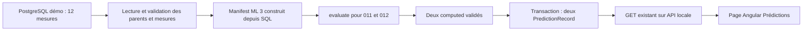

# ML 5.1 — Préparation du pilote fonctionnel local P101

Date : 25 octobre 2026. Statut : proposition documentaire, sans implémentation.

## 1. Décision proposée et référence

Réaliser une démonstration locale dans **une nouvelle instance PostgreSQL**, avec
un lanceur explicite qui lit les douze températures en base, appelle le moteur pur
ML 3, persiste les deux résultats dans une transaction et les expose à la page
Angular Prédictions existante. Un index unique ciblé suffit pour ce scénario fixe ;
aucun registre d'idempotence concurrente complet ni infrastructure TLS/HMAC du
service P101 protégé n'est nécessaire à cette première démonstration locale.

Ce chemin sera un **profil de démonstration séparé**. Il ne modifie, ne désactive
et ne remplace aucune garde, approbation, migration ou protection de
`app/p101_postgres`. Aucun drapeau permettant de désactiver TLS/HMAC dans ce service
n'est proposé. Le nouveau profil ne doit jamais être exécuté sur une base portant
le schéma protégé `p101_pilot`, ni sur industrial_predict_dev.

Référence vérifiée : dépôt `D:/projets/industrial-predict`, branche
`feature/ml-4-p101-persistence`, HEAD
`3dd18830feaf11947c1739ea3bf45133c7b7cedc`, arbre propre et index vide au départ.
Seul ce rapport est créé. Aucun import applicatif exécuté, calcul ML, test/build,
accès PostgreSQL/HTTP, création Docker, migration, certificat, secret ou changement
de code. Aucun commit, push, merge ou rebase ; main inchangée. L'implémentation
reste soumise à validation explicite.

Références conservées : [ML 3](ml-3-p101-anomaly-core.md),
[ML 4.1](ml-4.1-p101-persistence-design.md),
[ML 4.2A](ml-4.2a-p101-persistence-contracts.md),
[ML 4.2B-1](ml-4.2b1-p101-persistence-implementation.md),
[durcissement](ml-4.2b21-p101-sandbox-hardening.md),
[P1 Docker](ml-4.2b22-p101-docker-preflight.md),
[P2.1 TLS](ml-4.2b22-p101-tls-readiness.md).

## 2. Composants existants examinés et réutilisation

| Composant | Ce qu'il fournit | Décision pour le profil local |
| --- | --- | --- |
| `backend/app/anomaly_detection/p101_core.py` | evaluate(manifest, target_id, cutoff, prepared_at, run_id, code_revision), computed/abstained, contrôle des dix références et statistiques | Appeler directement evaluate, sans reconstruire l'algorithme |
| `p101_contracts.py`, `p101_canonical.py` | Identités logiques, onze codes d'abstention, normalisation UTC, empreintes, validate_proposal via le core, JSON borné | Réutiliser sans changer les contrats ML 3 |
| `statistical_detector.py` | Comparaison de l'écart à trois écarts-types, déjà appelée par evaluate | Réutilisation indirecte par ML 3, sans détecteur parallèle |
| `tests/p101_anomaly/fixtures/p101-temperature-v1.json` | Douze observations synthétiques, unités, qualité, timestamps, available_at et identités | Source unique du bootstrap et des métadonnées synthétiques ; pas source de substitution des valeurs lors du calcul SQL |
| `backend/app/models/measurement.py` | id, sensor_id, timestamp avec fuseau, value, quality ; relation au capteur | Lire ces colonnes et les parents ; pas de available_at ni fixture_id en base |
| `backend/app/models/prediction_record.py` et sa migration d6ec01cf13b6 | Les quatorze champs attendus par l'API/Angular, JSON et dates avec fuseau | Conserver le schéma métier ; ajouter seulement les contraintes locales proposées dans la nouvelle instance |
| `MeasurementRepository.get_by_sensor_and_period` | Filtre capteur, bornes inclusives, tri ascendant | Sémantique adaptée à la fenêtre ; ne pas utiliser get_all, ni filtrer good avant de vérifier les données |
| Autres lectures MeasurementRepository | Certaines méthodes paginent en décroissant et utilisent une fin exclusive | Ne pas confondre ces conventions avec la fenêtre d'évaluation ML 3 |
| `PredictionRepository.create` | add/flush/refresh, sans commit | Compatible conceptuellement avec une transaction externe ; import ORM à contrôler avant usage |
| `PredictionService.create`, persist_anomaly | Commit interne par prédiction ; persist_anomaly réduit les détails | Ne pas les appeler pour écrire le lot de deux résultats |
| ML 4.2A `canonical.py`, `preparation.project_content` | build_key/IdempotencyTuple, projection métier, comparaison de contenu hors base | Réutiliser ces fonctions pures ; aucune HMAC nécessaire pour calculer une clé ou comparer des contenus |
| ML 4.2A prepare_batch/target_key et mapping ML 4 PostgreSQL | Dossier et destination contractuelle industrial_predict_ml_sandbox, enrichissement SQL détaillé | Ne pas les détourner vers une autre base : le profil local prépare son mapping fin, en reprenant les invariants utiles |
| `backend/app/p101_postgres/tables.py` | Métadonnées Core indépendantes du moteur global, dont prediction_records | La Table prédictions peut être utilisée sans créer les objets du registre ; ne pas appeler metadata.create_all |
| `backend/app/api/routes/equipment.py`, get_equipment_predictions | GET paginé, filtres type/niveau/alerte/période, service de lecture existant | Réutiliser le handler et son contrat dans une API locale en lecture seule |
| Angular PredictionsApiService, façade, modèle PredictionRead et composants existants | Validation des 14 champs, sélection des parents, liste, détails JSON, filtres | Réutiliser sans refonte ni calcul dans Angular |

Les fichiers génériques peuvent construire un moteur à l'import via
`app.core.database` et `settings`, qui lit `.env`. L'injection d'une Session dans
un repository ne suffit donc pas à rendre son import indépendant de DEV. Pour le
lanceur de calcul, privilégier les Tables Core indépendantes et une lecture Core
ciblée des mesures/parents. Pour la lecture API, traiter explicitement l'amorçage
du processus décrit en section 7, avant tout import de routes génériques.

## 3. Parcours PostgreSQL → ML 3



### Données initiales et rattachements

Créer ultérieurement une entreprise, un site, une pompe et un capteur aux codes
logiques P101 existants, en allouant les ids dans la nouvelle base. Charger les
douze valeurs et dates de la fixture sans importer de données DEV. L'équipement
doit porter un nom de démonstration synthétique, equipment_type pump,
**status operational** et criticality medium ; capteur temperature, unité °C,
status active. Tous les champs nécessaires aux DTO de référence doivent être
présents, y compris les dates de création/modification.

Écart statique identifié : le plan de bootstrap protégé actuel affecte le statut
active à l'équipement ; EquipmentRead attend operational/maintenance/out_of_service.
Ce bootstrap ne doit donc pas être réutilisé tel quel pour un parcours Angular.
Le nouveau profil emploiera operational pour l'équipement et active pour le
capteur. Aucun correctif du service protégé n'est effectué par ce rapport.

### Adaptateur SQL vers manifeste

1. Ouvrir une transaction avec la factory locale explicite et vérifier destination,
   rôle, marqueur d'instance et version avant lecture métier ou écriture.
2. Résoudre les quatre codes industriels et vérifier toute la chaîne
   Company → Site → Equipment → Sensor. Ne jamais fixer les ids à ceux des tests.
3. Lire **toutes** les mesures du capteur de démo ; exiger exactement les douze
   instants attendus, sans doublon, valeur manquante/non finie ou qualité différente
   de good. Trier par timestamp puis id. Une mesure bad doit provoquer un refus,
   pas disparaître derrière un filtre de qualité.
4. Associer chaque ligne SQL à son fixture_id par l'instant canonique attendu,
   avec une table de correspondance fixture_id → id SQL. Reconstruire value,
   timestamp et quality à partir des lignes SQL ; unit depuis Sensor et parents
   depuis les rattachements réellement vérifiés.
5. Compléter uniquement les métadonnées absentes du schéma SQL depuis la fixture
   approuvée : fixture_id, available_at et marqueur synthetic. Comparer le manifeste
   reconstruit à l'empreinte canonique de fixture contractuelle. Une divergence
   SQL arrête la démonstration ; ne jamais remplacer une valeur SQL divergente
   par sa valeur JSON pour obtenir un résultat attendu.
6. Appeler evaluate deux fois avec le même run_id de tentative et prepared_at UTC,
   après les cutoffs. Fournir la révision du code de calcul effectivement revue ;
   une chaîne SHA déclarée seule ne certifie pas sa provenance.
7. Exiger exactement deux Computed, valider les propositions et refuser tout lot
   partiel, doublon ou Abstained. Aucun score normal implicite lors d'une abstention.

Le modèle Measurement ne conserve pas available_at. Le mécanisme décrit est donc
adapté à une fixture synthétique figée et attestée, pas à une preuve de disponibilité
temporelle d'une acquisition industrielle réelle. Une telle acquisition demanderait
une évolution distincte du contrat de données.

### Fenêtres et résultats attendus

Les résultats suivants proviennent des validations ML 3 déjà documentées ; aucun
calcul n'est relancé dans ML 5.1.

| Cible | Références réellement requises | Cutoff | Attente ML 3 |
| --- | --- | --- | --- |
| DEMO-M-011, 11 janvier 2026 à 08:00 UTC, 65 °C | DEMO-M-001 à 010, dix jours antérieurs | 11 janvier à 08:01 UTC | score 0, is_alert false |
| DEMO-M-012, 12 janvier 2026 à 08:00 UTC, 70 °C | DEMO-M-002 à 011, dix jours antérieurs | 12 janvier à 08:01 UTC | score 1, is_alert true |

Dans les deux cas attendus : moyenne 65 °C, écart-type d'échantillon 1 °C, seuil
3 °C ; décision stricte abs(value − mean) > 3 × std, score binaire non probabiliste.
La deuxième fenêtre inclut 011 parce qu'elle est déjà passée et disponible ; elle
n'utilise pas systématiquement les dix premières lignes. Aucune fenêtre n'inclut
sa propre cible ou une mesure future comme référence.

Il s'agit d'un détecteur statistique, sans entraînement, artefact appris ou
probabilité de panne. Le parcours fonctionnel n'établira aucune capacité de
prédiction de défaillance industrielle.

## 4. Persistance minimale et prévention des doublons

### Contrat et contrainte SQL proposés

Conserver les 14 champs PredictionRecordRead : ids alloués/réels, type anomaly,
modèle statistical_deviation, version p101-stat-v1, score 0/1, is_alert cohérent,
level et horizon_hours null, predicted_at égal à l'instant de la cible,
created_at UTC de première persistance, details JSON borné.

Ajouter une migration **propre au nouveau profil et à sa seule base** :

- Un petit marqueur local_demo.environment, singleton avec UUID d'instance,
  purpose local-p101-functional-demo, nom de base et bootstrap fermé ; lecture
  seule pour writer/reader. Il ne remplace pas le marqueur p101_pilot.
- Un index UNIQUE partiel sur prediction_records pour le profil anomaly /
  statistical_deviation / p101-stat-v1, portant sur
  **(equipment_id, sensor_id, measurement_id, model_name, model_version)**.
- Un CHECK ciblé sur ce profil imposant sensor_id/measurement_id non nuls,
  score binaire, is_alert non nul/cohérent, level/horizon null, détails synthétiques
  du schéma local et métadonnées de clé/contenu valides. Les vérifications JSON
  obligatoires devront employer une logique refusant NULL, pas un CHECK qui
  réussirait silencieusement sur une expression SQL inconnue.

Sémantique volontairement simple : **un résultat par cible SQL et version de
méthode** pour cette fixture figée. Un changement de cutoff, référence ou contenu
sur la même cible/version est un conflit, pas un nouvel enregistrement. Une
nouvelle version de méthode ou un autre scénario exige une validation distincte.
La contrainte UNIQUE PostgreSQL est nécessaire ; un SELECT préalable ou un hash
Python seul ne protège pas contre les courses.

Les clés logiques et empreintes de contenu peuvent reprendre build_key avec
IdempotencyTuple et project_content, sans prepare_batch ou DestinationDeclaration
détournés. L'UUID est celui de la nouvelle instance. Run_id, prepared_at, created_at
et ids alloués ne changent pas la clé logique. La correspondance aux ids SQL est
vérifiée séparément. La règle naturelle UNIQUE, plus restrictive que le registre
ML 4, empêche plusieurs résultats sur une même cible/version, même si un cutoff
différent produit une autre clé logique.

### Détails JSON locaux

Utiliser un schéma distinct `p101-local-demo-details-v1`, avec synthetic true,
reason lisible par Angular, calculation contenant les détails logiques ML 3
inchangés, et local_demo contenant UUID d'instance, clé, empreinte de contenu,
version du raccordement et correspondances fixture_id/ids SQL. Les données de
calcul ne doivent pas être faussement renommées comme un schéma ML 4 validé.
La valeur producer.revision_status de ML 3 reste honnête ; aucune authentification
HMAC ou provenance serveur certifiée n'est inventée.

Valider le JSON final avec les bornes ML 3 : au plus 6 000 octets UTF-8, six niveaux
de conteneurs, chaînes de 240 caractères, nombres finis. Le budget du conteneur
ajouté doit être vérifié avant INSERT. Ne pas dupliquer le contenu canonique complet
dans details uniquement pour le hash : le recalculer depuis calculation lors
d'une comparaison de retry et comparer aussi ses octets canoniques, pas seulement
les empreintes.

### Une transaction pour le lot

Le lanceur local détient une seule connexion/session fraîche en READ COMMITTED :

1. begin, garde de destination, verrou advisory transactionnel exclusif du profil ;
2. lecture et validation des sources, construction du manifeste, deux évaluations
   ML 3 et validation des propositions ;
3. lecture des résultats existants sur les deux clés naturelles ; zéro ou deux
   lignes seulement sont admissibles ;
4. zéro ligne : préparer/valider les deux mappings puis effectuer les deux INSERT
   dans cette transaction, récupérer ids/dates, valider les 14 champs finaux ;
5. deux lignes : comparer contenu métier canonique, scores/versions/dates cibles
   et correspondances SQL ; si identiques, retourner les ids, created_at et détails
   originaux sans UPDATE ni nouvelle ligne ; sinon, conflit explicite ;
6. un seul résultat existant : refuser tout le lot, sans réparation automatique ;
7. commit unique après validation complète ; rollback de tout le lot sur une erreur
   connue avant commit.

Le verrou advisory sérialise les appels coopérants du lanceur. Le writer ne possède
pas UPDATE sur les mesures : aucune lecture FOR SHARE nécessitant des privilèges
supplémentaires ou fonction SECURITY DEFINER n'est ajoutée. Les sources sont
immuables pour les rôles runtime ; le bootstrap owner est terminé et inactif.
Toute maintenance privilégiée future doit respecter le même verrou et une nouvelle
autorisation. Le verrou advisory ne bloque pas un administrateur qui l'ignore.

L'index reste le filet contre une course sur les insertions. Une violation UNIQUE
inattendue annule la transaction entière ; une nouvelle transaction gardée peut
relire et comparer le lot, avec reprise bornée. Ne pas faire deux commits, un
ON CONFLICT DO NOTHING silencieux ou une validation après le premier commit.
Le service PredictionService.create et les persist_* génériques restent exclus.

En cas de perte de connexion au commit, résultat inconnu : ouvrir ultérieurement
une lecture gardée sur les deux clés naturelles. Deux lignes identiques confirment
le résultat ; zéro ligne signifie non observé à cet instant ; une ligne ou un
contenu différent constitue une anomalie. Aucun succès/rollback affirmé sans
preuve, aucune nouvelle insertion automatique aveugle. Des trous de séquence
après rollback sont admis.

Cette prévention couvre le parcours du lanceur local. Elle ne constitue pas une
preuve équivalente au registre, aux triggers inverses et au contrôle de contenu
concurrent du service ML 4 protégé, ni une défense contre un writer malveillant
inventant d'autres cibles ou versions.

## 5. Instance locale indépendante et transport simplifié

Propositions à approuver et vérifier avant toute création :

| Élément | Proposition |
| --- | --- |
| Projet / conteneur | industrial-predict-p101-local-demo / industrial-predict-p101-local-demo-postgres |
| Base | industrial_predict_p101_local_demo, nom différent de DEV et du sandbox protégé |
| Volume de données | industrial-predict-p101-local-demo-data, neuf, monté au PGDATA PostgreSQL 17 attendu |
| Réseau | industrial-predict-p101-local-demo-net, dédié, sans rattachement DEV ; subnet/IP à vérifier |
| Publication SQL | 127.0.0.1:55432 vers 5432, disponibilité à revérifier ; aucun port réservé ici |
| API / Angular | 127.0.0.1:8001 et 127.0.0.1:4201, ports proposés non vérifiés/réservés |
| Rôles | Nouveaux owner/migrateur, writer du lanceur et reader API, secrets distincts et privés ; aucun compte DEV |
| Image candidate | Référence immuable PostgreSQL 17.10 déclarée dans P1, digest ci-dessous ; absence/divergence entraîne l'arrêt |

```text
docker.io/library/postgres@sha256:7958605b474b3d264a969cb3a123d6aa00ad1e1fe9da8a69984dabb704d93317
```

Ces noms et ports ne sont pas ceux d'une infrastructure créée. L'inventaire P1
est historique : ses constats de disponibilité doivent être refaits avant usage.
Aucun dump, clonage, volume, réseau, identifiant ou secret DEV ne doit être repris.
Une base vide dans un cluster déjà utilisé pour DEV ne répond pas à cette séparation.

Pour ce seul profil de démonstration sur un hôte de confiance, proposer un transport
SQL explicitement **sans TLS**, limité à loopback et au réseau Docker dédié,
avec SCRAM et comptes à privilèges minimaux. Aucun fallback opportuniste entre
TLS et clair : le mode local est explicite et refusé pour toute autre topologie.
Les flux internes hôte/VM ne sont pas chiffrés ; les administrateurs et processus
locaux privilégiés restent de confiance. Ce choix n'est pas adapté à une machine
partagée non fiable, un réseau distant, une exposition SaaS ou des données réelles.

La configuration privée locale doit imposer le host littéral 127.0.0.1, le port
approuvé, le nom exact de base, les rôles nouveaux et l'UUID/purpose du marqueur.
Refuser toute configuration absente, héritée ou nom de base différent avant
connexion, puis comparer base/port/adresse serveur, rôle et marqueur effectivement
lus avant écriture. Les premières migrations sont gardées par destination/owner
explicites avant création du marqueur. Aucun essai de refus ne doit contacter DEV.

Le writer lit les sources et insère les seules prédictions du parcours ; aucune
mutation de mesures, recommandations ou maintenance. Le reader ne lit que les
références et prédictions nécessaires ; aucune écriture/DDL. Retirer les droits
PUBLIC/TEMP/CREATE non nécessaires et les memberships hérités. Owner n'est utilisé
que pour schéma et fixture, puis fermé pour l'exécution normale.

Les neuf révisions générales seront réutilisées via un **nouvel environnement
Alembic local**, recevant une connexion owner explicitement fournie, suivi d'une
seule révision locale (marqueur/index/CHECK). Ne pas appeler env.py général qui
recharge les settings DEV, ni l'entrée admin ML 4 qui exige TLS/HMAC. Ne pas
appliquer p101_0001 ou créer p101_pilot sur cette base. Les migrations générales
existantes ne sont pas réécrites et aucune migration n'est exécutée aujourd'hui.

## 6. Modifications minimales proposées, non réalisées

| Périmètre futur | Contenu minimal |
| --- | --- |
| `backend/app/p101_local_demo/` nouveau package | Configuration/factory explicites, garde locale, adaptateur SELECT → manifeste, mapping et lanceur transactionnel ; séparation en quelques modules testables à l'implémentation |
| Entrée API locale dédiée dans ce package | Amorçage contrôlé puis réutilisation des handlers GET existants avec session reader ; aucun nouveau POST prédictif |
| `backend/local_demo_migrations/` nouveau | Env recevant la connexion owner, sources générales réutilisées, une révision locale ciblée ; pas de modification des historiques existants |
| Outil de préparation local dédié | Charger seulement la fixture et les quatre parents conformes aux DTO, ids alloués, marqueur fermé ; aucun seed DEV |
| Configuration d'exécution locale | Nouveau Compose dédié et configuration privée hors Git sans valeurs réelles dans les exemples ; proxy Angular distinct, passé explicitement au lancement |
| Tests ciblés nouveaux | Adaptateur pur, transactions PostgreSQL réelles sur instance jetable dédiée, GET et test Angular existant alimenté par les résultats |

Une seule commande opérateur de calcul sur instance déjà provisionnée suffira au
parcours ; son nom/interface seront fixés à l'implémentation. Le bootstrap et la
migration restent des opérations distinctes, jamais des effets de bord d'un GET,
d'un import ou du chargement d'une page Angular.

Les composants app/p101_postgres, ses approbations et ses migrations restent
intacts. Aucun choix de TLS-01 ou de PKI n'est implicitement résolu par ce profil.

## 7. Lecture API et affichage Angular sans refonte

### Réutiliser le GET existant sur un processus isolé

Le handler est dans `backend/app/api/routes/equipment.py` :
GET `/api/v1/equipments/{equipment_id}/predictions`. Il valide les filtres,
appelle PredictionService.get_paginated et renvoie Page[PredictionRecordRead].
La lecture vérifie Equipment, filtre par équipement, accepte les bornes temporelles
inclusives et trie predicted_at puis id décroissants. Aucun calcul n'y est déclenché.

Les imports des routes entraînent actuellement settings et core.database. Le futur
lanceur API doit donc démarrer un **processus neuf**, depuis un répertoire de
travail isolé sans `.env`, valider sa configuration locale avant les imports puis
fournir explicitement les seuls réglages reader de la démonstration. Pour la
compatibilité avec Settings générique, DATABASE_URL sera alors une valeur locale
explicitement construite par ce lanceur, jamais une valeur héritée ni un fallback.
Le job de calcul utilise sa propre factory et ignore DATABASE_URL.

Tester qu'aucun module applicatif n'a été préchargé avant cette phase, qu'aucun
.env n'est lu, et qu'aucun moteur DEV n'est construit. Une simple substitution
de get_db après import de l'application habituelle est insuffisante. Le moteur
global éventuellement créé par les imports doit déjà être celui du reader démo ;
la dépendance get_db de l'application locale est liée à la session reader gardée.
Ne pas lancer directement app.main avec son environnement habituel.

La nouvelle factory API réutilise exclusivement les GET nécessaires des routers
existants, sans modifier leurs sources : listes et détails companies/sites/equipments,
puis historique predictions. Elle n'enregistre pas les POST/PUT/PATCH/DELETE,
calculs RUL, recommandations ou health-score. Un GET d'identité locale non sensible
peut identifier le purpose de démonstration ; aucun secret ou DSN en réponse.
Le processus reste lié à loopback et utilise debug false.

### Prérequis de la page Angular actuelle

La façade Prédictions exige une sélection explicite entreprise → site → équipement
et vérifie les rattachements par des GET de détail avant l'historique. Exposer
uniquement le GET predictions laisserait donc la page inopérante. Les catalogues
paginés et détails des trois références doivent viser la même base reader.

Le préfixe Angular reste `/api/v1`. Le proxy courant vise 127.0.0.1:8000 : le
conserver pour l'existant et passer un proxy distinct ciblant l'API démo 8001 au
processus Angular démo sur 4201. Aucun endpoint ML, calcul côté navigateur ou
changement de composant n'est nécessaire. Les ports sont des propositions, pas
des services démarrés dans cette mission.

Ouvrir ultérieurement la page `/predictions` de cette instance, sélectionner les
références synthétiques et appliquer type anomaly, sans filtre de niveau, alerte
Tous, page 1. Une URL de démonstration peut fournir company_id/site_id/equipment_id
**réels retournés par le bootstrap**, jamais des ids présumés. Ne pas filtrer par
la date du jour : predicted_at est en janvier 2026, created_at est la date de
persistance. Laisser la période vide ou encadrer les 11–12 janvier explicitement.

Attendu visuel : deux lignes, d'abord 012 puis 011 ; « Indice d'anomalie » 1 puis 0,
alertes Oui puis Non ; modèle statistical_deviation, version p101-stat-v1, niveau
« Non renseigné », motif de démonstration et JSON consultable. Angular ne doit
pas convertir ces valeurs en probabilités. Les statistiques sont consultables
dans calculation via l'aperçu JSON existant ; aucun graphique additionnel requis.
Le bouton Actualiser relit le GET, il ne déclenche ni calcul ni écriture.

## 8. Étapes futures et validations avant chaque opération

| Étape | Travail futur après autorisation | Validation de sortie |
| --- | --- | --- |
| V0 | Valider ce profil local et sa réduction de garanties ; approuver les fichiers d'implémentation | Aucun changement du service protégé ; transport loopback clair accepté pour cette seule démo synthétique |
| V1 | Implémenter les adaptateurs/factory/lanceurs et tests purs ciblés | Aucun import DEV ou accès externe dans les tests purs ; mapping et abstentions conformes |
| V2 | Autoriser puis créer les nouvelles ressources indépendantes, config privée et rôles | Inventaire noms/ports/image, absence de montage ou secret DEV ; identité effective du cluster/base/owner conforme |
| V3 | Autoriser les migrations générales + locale et le bootstrap des seules sources | Quatre parents conformes aux DTO, douze mesures exactes, zéro prédiction, marqueur fermé, owner inactif |
| V4 | Autoriser la première commande PostgreSQL → ML → persistance | Deux computed et deux PredictionRecord après un commit ; relecture sur connexion indépendante |
| V5 | Valider retry, rollback, conflits et courses sur fixture jetable | Aucun doublon, aucun remplacement ni lot partiel ; sources inchangées |
| V6 | Autoriser l'API reader et les accès HTTP/browser de la démo | Contrats GET/catalogues conformes, reader sans écriture ; aucun accès DEV ou POST exposé |
| V7 | Ouvrir Angular et effectuer la vérification du parcours | Deux lignes issues de SQL, filtres cohérents, Actualiser sans effet de bord ; preuve finale d'intégrité |

Chaque étape s'arrête si destination, marqueur, rôle, schéma, fixture ou contenu
diverge. Aucun nettoyage automatique, adoption de base existante, arrêt d'un
service DEV ou migration de rattrapage n'est déclenché pour forcer le scénario.
Toutes ces étapes sont futures ; ce rapport n'en autorise aucune exécution.

## 9. Tests minimums du parcours complet

| Test futur | Preuve nécessaire |
| --- | --- |
| L01 — Configuration/isolation | Configuration absente, DEV, host non loopback, mauvais rôle/marqueur/version refusés ; aucune tentative de connexion DEV ; import API sans lecture de .env ni moteur hérité |
| L02 — Adaptateur SQL | Douze lignes et parents conformes reconstruisent le manifeste canonique ; mauvaise valeur/qualité/unité/parent/date, doublon ou manque refusés ; preuve qu'aucune valeur JSON ne remplace SQL |
| L03 — Calcul synthétique | SQL → evaluate donne 011=0/false et 012=1/true, références 001–010 puis 002–011 ; onze abstentions ML 3 conservées, lot non computed non persisté |
| L04 — Commit nominal réel | Zéro puis deux lignes ; ids SQL, FK, quatorze champs, détails bornés, dates et scores relus par une nouvelle connexion PostgreSQL |
| L05 — Retry/contenu | Nouvelle tentative identique conserve ids/created_at/détails ; changement de cutoff/référence/contenu sur même cible/version refusé, aucune mise à jour |
| L06 — Atomicité réelle | Erreur injectée après première insertion et avant commit : nouvelle connexion ne voit aucune ligne du lot ; cas partiel préexistant refusé ; trous de séquence admis |
| L07 — Unicité/course | Deux commandes concurrentes sur la même fixture : une paire unique, mêmes ids au retry ; vérifier l'index réel et une collision hors verrou coopérant, rollback global puis relecture |
| L08 — API et références | DTO EquipmentRead avec operational, catalogues et détails parents, GET 14 champs/total=2, filtre alerte vrai/faux=1 chacun, bornes inclusives, ordre et pagination ; aucune écriture par reader |
| L09 — Angular fonctionnel | Page existante depuis le proxy démo, sélection/URL avec ids réels, deux lignes et détails, Actualiser sans calcul ; aucune requête vers API DEV ni méthode d'écriture |
| L10 — Intégrité | Inventaires avant/après de la seule base démo : sources, maintenance et recommandations inchangées ; seules deux prédictions ajoutées ; aucun endpoint ni compte DEV utilisé |

Un test de résolution d'un commit incertain sur infrastructure jetable sera
nécessaire avant d'affirmer une garantie robuste sur coupure réseau ; un mock
ne vaut pas cette preuve. SQLite ne remplace pas L04–L07 PostgreSQL. Les tests
existants ML 3 et GET/Angular servent de référence ; relancer seulement ceux
affectés lors de l'implémentation future, avec résultats réellement rapportés.

**Aucun test de ce plan, ni ancien test, ni calcul de contrôle n'a été exécuté
dans ML 5.1.** Les attentes numériques proviennent des rapports validés antérieurs.

## 10. Limites et réserves conservées

Le pilote est une preuve de raccordement et de persistance reproductible sur douze
températures synthétiques. Il ne fournit ni apprentissage, probabilité de panne,
RUL, health_score, collecte réelle, validation statistique externe, isolation
multi-tenant, haute disponibilité ou exploitation industrielle.

Le transport local sans TLS et l'autorisation opérateur simple ne reprennent pas
les garanties TLS/HMAC, registre et catalogue exhaustif du chemin ML 4. Les points
R01–R03 et R06–R07 de ce chemin restent préparés mais non validés sur PostgreSQL ;
R04–R05, R08–R09 et TLS-01 conservent leurs prérequis/limites. La démonstration
locale ne clôt ni ces réserves ni les tests I01–I12 du service protégé.

| Réserve | État pour ce rapport |
| --- | --- |
| B-PRE-01 | Ouverte : usage local de confiance, aucune autorisation multi-tenant |
| B-PRE-02 | Ouverte : score P101 binaire explicite, contrats génériques inchangés |
| B-PRE-03 | Ouverte : dates/cutoffs définis, available_at SQL absent ; tests temporels futurs |
| B-PRE-04 | Ouverte : rattachements proposés, aucune preuve SQL exécutée |
| B-PRE-05 | Ouverte : JSON local borné à implémenter et tester, aucun durcissement générique |
| B-PRE-06 | Ouverte : cascades générales inchangées ; aucune suppression de parents DEV |
| B-PRE-07 | Ouverte : ordre/pagination existants, pas de garantie générale de snapshot ou performance |
| B-PRE-08 | Ouverte : chemin à commit interne écarté du plan ; aucune transaction réelle prouvée |
| B-PRE-09 | Ouverte : aucune alimentation réelle ou orchestration générale réalisée |
| B-PRE-10 | Ouverte : provenance déclarée, sans authentification cryptographique locale ni attestation serveur |
| B-PRE-11 | Ouverte : liste existante suffisante ; aucune nouvelle route détail/latest proposée |

## 11. État Git final et validation attendue

Branche et HEAD conservés ; index vide. Seul fichier nouveau :
`docs/ml-5.1-local-functional-pilot.md`. Aucun fichier suivi, code, migration,
configuration frontend/DEV ou main modifié. Contrôles finaux conformes : périmètre
limité au rapport, `git diff --check` et contrôle `git diff --no-index --check`
du nouveau fichier sans erreur d'espacement ; recherche de motifs de secrets/DSN
sans résultat, onze réserves ouvertes conservées. Aucune indexation ni aucun commit.

**Valider d'abord le profil proposé et les limites de garantie. Aucune
implémentation, ressource, connexion ou première exécution n'est commencée.**
